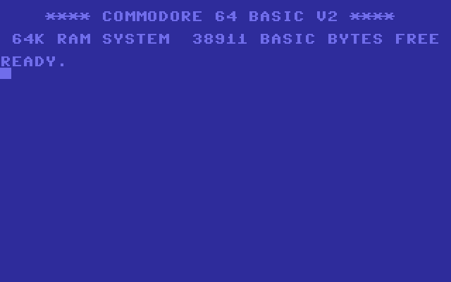

# 6502 SBC Emulator

[](https://github.com/rudolfstepan/6502-sbc-emulator/actions/workflows/ci.yml)
[](LICENSE)

A C99 6502 emulator with two machine profiles, **6502 SBC** and **Commodore 64 (PAL)**.
Both use SDL2 video and audio and share an interactive machine monitor. The
SBC profile includes MS BASIC, EhBASIC, standalone chess, and a 4-voice sound
demo. The [C64 profile](docs/C64.md) uses locally supplied Commodore ROMs.

## Highlights

- MOS 6502 CPU core (all 151 official opcodes)
- Integrated Klaus Dormann 6502 functional CPU test in the default test pipeline
- Memory-mapped VIA 6522, UART 6551, DISK MVP, VIC text/bitmap/sprite display with blitter and interrupt system
- **FPGA ROM compatibility** for the SBC split-ROM layout, including the
  fixed-point math coprocessor and the accelerated Mandelbrot demo
- **4-voice sound chip** with ADSR envelopes and per-voice waveform selection (sine, square, sawtooth, triangle, noise)
- SDL2 display and audio backend
- **C64 mode** with PAL VIC-II raster graphics and sprites, SID audio, read-only
  D64 loading, and an F12 menu for keyboard and joystick remapping
- Interactive machine monitor (registers, memory dump, disassembly, stepping, breakpoints)
- Ready-to-run configs for MS BASIC (`sbc.ini`), EhBASIC (`ehbasic.ini`), chess (`chess.ini`), and the 4-voice sound demo (`soundtest.ini`)
- ROM build scripts for kernel, MS BASIC, EhBASIC, chess, and the soundtest ROM
- **MultiCalc**, an 80-column Multiplan/Lotus-class spreadsheet built as a cc65 PRG for the FPGA target (`make spreadsheet`; see [docs/MULTICALC.md](docs/MULTICALC.md))

## Quick Start

Clone the emulator. For FPGA ROM development, check out the FPGA project next
to it so the build can find the original ROMs:

```sh
git clone https://github.com/rudolfstepan/6502-sbc-emulator.git
git clone https://github.com/rudolfstepan/6502-sbc-fpga.git
cd 6502-sbc-emulator
```

The FPGA checkout is optional for the standard SBC and C64 emulator build.

Build:

```sh
make
```

After build, a runnable bundle is staged in `bin/` (binary + config files + ROM files + runtime DLLs on Windows).

Run MS BASIC setup:

```sh
cd bin
./sbc6502 sbc.ini
```

Run EhBASIC setup:

```sh
cd bin
./sbc6502 ehbasic.ini
```

Run standalone chess ROM:

```sh
cd bin
./sbc6502 chess.ini
```

Run the 4-voice sound demo (~60 second looping ambient/arp song):

```sh
cd bin
./sbc6502 soundtest.ini
```

### Run the same ROM on the emulator and FPGA

Use `fpga.ini` to run an original Tang Primer 20K SBC ROM built for the
16 KiB split layout. The emulator reads the FPGA binary directly, maps both
ROM windows, and starts from its reset vector.

For example, with `6502-sbc-fpga` and `6502-sbc-emulator` checked out next
to each other, run the accelerated Mandelbrot demo from the emulator folder:

```powershell
cd bin
$rom = '..\..\6502-sbc-fpga\roms\6502\mandelbrot_copro.bin'
.\sbc6502.exe fpga.ini --load $rom
```

The demo uses the SBC's signed fixed-point coprocessor at `$88B0-$88BF`
and draws a 320×200 RGB332 image. Use the same `mandelbrot_copro.bin` with
the FPGA monitor uploader. The split layout, upload command, and register
map are documented in [FPGA compatibility](docs/FPGA_COMPATIBILITY_STATUS.md#rom-and-prg-loading).

### Commodore 64 (PAL)



See the [C64 mode guide](docs/C64.md) for ROM setup, disk loading, and
keyboard and joystick configuration.

Place the C64 BASIC (8192 bytes), KERNAL (8192 bytes), and character generator
ROM (4096 bytes) in `roms/c64/` as `basic.rom`, `kernal.rom`, and `chargen.rom`.
Run `make` to stage the ROMs and `c64.ini` under `bin/`.
On Windows, double-click `Start-C64.bat` in the project directory. It reads
the project directory's `c64.ini` at each launch.
From a terminal, run `sbc6502 c64.ini` while in `bin/`.

The C64 profile supports BASIC, keyboard input, raster-split text and bitmap
modes, hardware sprites, and basic SID audio. See [C64 architecture and current coverage](docs/ARCHITECTURE.md#c64-profile).

Drop a 35-track `.d64` onto the C64 window to mount it read-only. In BASIC,
enter `LOAD "$",8` and `LIST` to see its directory, or `LOAD "*",8,1` to
load the first PRG at its saved address. Use `RUN` for a BASIC program.
Named PRGs can be loaded with `LOAD "NAME",8`.

The `[floppy]` section in `c64.ini` sets the device number (8–11) and an
optional startup image. Paths are relative to the working directory.

```ini
[floppy]
device = 8
image = data/sdcard/example.d64
```

In C64 mode, Escape and Tab send `RUN/STOP`, and Page Up sends `RESTORE`.
Close the window to exit.

Press **F12** for the C64 configuration menu. Use Tab to switch pages, the
arrow keys to navigate or change a value, and Enter to edit a value or
capture a key or controller input. Delete restores a selected binding's
default. **F2** saves to the active INI file. F12 closes the menu and
discards unsaved edits.

Window scale and input settings apply on save. The settings marked `*`,
including the CPU, ROMs and floppy, apply on the next start. You can drop
a `.d64` onto the open menu to choose a startup image.

Set the C64 joystick to port 1 or 2 to enable it. The default keyboard
joystick uses the arrow keys and Right Ctrl for fire. The first connected
SDL joystick or gamepad also works and can be remapped on the Joystick page.

### Nintendo NES / Famicom

Use `nes.ini` to start the NES profile in the SDL window. Install the optional
[FCEUmm libretro core](https://docs.libretro.com/library/fceumm/) under `bin/cores/`
beside the executable. On Windows x64, extract `fceumm_libretro.dll` from the
[official Windows core archive](https://buildbot.libretro.com/nightly/windows/x86_64/latest/fceumm_libretro.dll.zip).
On Linux, use `fceumm_libretro.so` from your system or the Libretro buildbot.
Set `[nes] core` to use a library in a different location.

```powershell
cd bin
.\sbc6502.exe nes.ini
.\sbc6502.exe nes.ini --load ..\nes-game.nes
.\sbc6502.exe nes.ini --load 'USA\Contra (U).zip'
```

In the `[nes]` section of either profile, set `rom_dir = ../roms/nes` to use
the `roms/nes/` folder under the project root when launching from `bin/`.
Set `rom` to your default cartridge's filename or path within that folder. `--load`
also accepts an absolute path or a file relative to the current working
directory. Drag a cartridge or a ZIP containing one cartridge onto the
NES window to switch games. The loader also accepts `.unf`, `.unif` and `.fds`.
Famicom Disk System images require `disksys.rom` in `[nes] system_dir`, which
defaults to the executable directory.

Use the arrow keys for the D-pad, Z for A, X for B, Enter for Start and right
Shift for Select. SDL game controllers work for up to two players. F5 resets
the game, F6 changes the FDS disk side, F7 inserts or ejects an FDS disk,
F8 inserts a Vs. System coin, and Escape closes the window. Cartridge battery
saves use the emulator's per-user NES directory (`%APPDATA%` on Windows).
Users supply their own original game ROMs and system firmware. Keep them in
the local ROM collection. See [ROM and distribution requirements](docs/THIRD_PARTY.md#roms-and-distribution).

Run `make test-nes` with a local FCEUmm core to exercise uncompressed and ZIP
loading, framebuffer capture, and invalid input using a generated test ROM.

#### NES with the SBC CPU

Build the optional adapted core with `make nes-sbc-core`. This uses Python 3,
GNU Make and the project's C compiler. The first build fetches the pinned
FCEUmm source archive and verifies its SHA-256. The adapted library goes in
`bin/cores/` under its own filename. Rebuild it after changing the CPU or bus
sources. The runtime package still supports `nes.ini` with the regular FCEUmm
library for comparison.

```powershell
cd bin
.\sbc6502.exe nes-sbc.ini --load ..\nes-game.nes
.\sbc6502.exe nes-sbc.ini --load 'USA\Contra (U).zip'
```

In `nes-sbc.ini`, `[nes] cpu = sbc` selects the 2A03 variant of the project's
6502 core and its bus for documented opcodes. FCEUmm schedules the CPU and
peripherals, provides the NES address handlers, DMA, interrupts, PPU, APU and
cartridge mappers, and executes undocumented or mapper-encrypted opcodes.
The adapter is instruction-based and is still being checked for CPU/PPU
timing compatibility. It uses a separate per-user battery-save directory
called `NES SBC CPU` so comparisons leave the reference profile's saves intact.
See the [NES architecture diagram](docs/ARCHITECTURE.md#nes--famicom-profiles).

`make test-2a03` verifies CPU arithmetic and bus access order. With the adapted
core built, `make test-nes-sbc` verifies cartridge loading and an indexed
PPU-status read through the NES frontend.

### Tests

Run tests:

```sh
make check
```

`make check` includes the Klaus Dormann 6502 functional test (`test-klaus-6502`) and downloads the upstream binary automatically on first run.

## Binary Downloads

If you do not want to build from source, download prebuilt bundles from GitHub Releases.

- Tags (for example `v1.2.0`) still point to source commits.
- Release assets contain ready-to-run bundles for Linux and Windows.
- Download the archive for your platform, extract it, then run from the extracted `bin/` directory.

Expected release assets:

- `sbc6502-linux-x86_64.tar.gz`
- `sbc6502-windows-x86_64.zip`

## Runtime Options

```text
./bin/sbc6502 [options] [config.ini]

Options:
  -r <rom>      load ROM file (overrides first ROM entry in config)
  -s <speed>    CPU speed in Hz (0 = unlimited, default 27 MHz FPGA)
  -d            start in monitor mode
  -m            print memory map and exit
  -h            show help
```

You can also drag and drop files onto the SDL display window:

- `.d64` (C64 mode): mounts a 35-track disk image read-only on the configured floppy device.
- `.prg`: loads at the two-byte PRG load address and starts execution there.
- `.rom` / `.bin`: reloads the configured ROM window(s) and resets the CPU.
- With `fpga.ini`, a 16 KB FPGA shadow ROM is split into `$A000-$CFFF` and `$F000-$FFFF`.

## Current Memory Map

The emulator has a mixed map of configurable and fixed devices.

```text
$0000-$7FFF   SRAM (configurable)
$8000-$87FF   VIC text/color RAM (fixed)
$8800-$880F   VIA 6522 (configurable base)
$8810-$8813   UART 6551 (configurable base)
$8820-$8823   PS/2 keyboard registers, or legacy BASIC disk when overlapped
$8824-$882F   FPGA D64 GoDrive / SD-card disk window (`fpga.ini`)
$8830-$8839   SOUND Voice 0 — freq / dur / vol / control / ADSR (fixed)
$8840-$884F   VIC blitter registers (fixed)
$8850-$888F   VIC sprite registers (fixed)
$8890-$8899   SOUND Voice 1 (fixed)
$889A-$88A3   SOUND Voice 2 (fixed)
$88A4-$88AD   SOUND Voice 3 (fixed)
$88B0-$88BF   FPGA signed fixed-point math coprocessor (fixed)
$8900-$89FF   VIC sprite pixel data (fixed)
$9000-$900F   VIC control registers + interrupt system (fixed)
$9010-$AF4F   VIC bitmap RAM (fixed)
$C000-$FFFF   ROM windows (configurable)
```

Notes:

- `sbc.ini` uses two ROM windows (`kernel.rom` + `msbasic.rom`).
- `ehbasic.ini` uses two ROM windows (`kernel.rom` + `ehbasic.rom`) for the same SBC kernel shell with EhBASIC at `$D000`.
- The FPGA compatibility registers at `$D000`, `$D400`, and `$DC00` are mapped only where they do not overlap a configured ROM window.
- `chess.ini` uses one 16 KB ROM at `$C000-$FFFF`.
- `soundtest.ini` uses one 16 KB ROM at `$C000-$FFFF` that drives all four sound voices directly.

## Sound Device

The sound chip provides **4 independent voices**, each with a 10-register block:

| Offset | Name    | Description                                |
|--------|---------|--------------------------------------------|
| +0     | FREQ_LO | Frequency, low byte                        |
| +1     | FREQ_HI | Frequency, high byte (Hz, range 20–12000)  |
| +2     | DUR_LO  | Note duration, low byte (ms)               |
| +3     | DUR_HI  | Note duration, high byte (ms)              |
| +4     | VOLUME  | Peak amplitude (0–255)                     |
| +5     | CONTROL | Bits 6–4 = waveform; bit 0 = trigger       |
| +6     | ATTACK  | Attack time (0–255 × 8 ms)                 |
| +7     | DECAY   | Decay time (0–255 × 8 ms)                  |
| +8     | SUSTAIN | Sustain level (0–255, fraction of VOLUME)  |
| +9     | RELEASE | Release time (0–255 × 8 ms)                |

**Voice base addresses:**

| Voice | Base    |
|-------|---------|
| 0     | `$8830` |
| 1     | `$8890` |
| 2     | `$889A` |
| 3     | `$88A4` |

**CONTROL register waveform bits [6:4]:**

| Value | Waveform              |
|-------|-----------------------|
| 0     | Sine                  |
| 1     | Square                |
| 2     | Sawtooth              |
| 3     | Triangle              |
| 4     | Noise (xorshift LFSR) |

Writing CONTROL with bit 0 set captures all current register values and triggers the note. All four voices mix in real time through SDL audio; the per-voice volume is scaled so four simultaneous max-volume voices stay within 0 dB.

**Example:** trigger Voice 0 with a triangle wave, slow attack, at 440 Hz for 1 s:

```asm
LDA #<440
STA $8830       ; FREQ_LO
LDA #>440
STA $8831       ; FREQ_HI
LDA #<1000
STA $8832       ; DUR_LO
LDA #>1000
STA $8833       ; DUR_HI
LDA #200
STA $8834       ; VOLUME
LDA #12
STA $8836       ; ATTACK  = 12 × 8 ms = 96 ms
LDA #6
STA $8837       ; DECAY   = 6  × 8 ms = 48 ms
LDA #128
STA $8838       ; SUSTAIN = 50 % of peak
LDA #10
STA $8839       ; RELEASE = 10 × 8 ms = 80 ms
LDA #$31        ; waveform = 3 (triangle) | trigger
STA $8835
```

The **soundtest ROM** (`soundtest.ini`) is a standalone 16 KB ROM that demonstrates the full sound chip. It plays a ~60-second looping composition built entirely from 6502 machine code:

1. Laser sweep intro (Voice 3, sawtooth)
2. 28-chord ambient section — Voice 0 triangle lead, Voice 1 sine pad (slow attack), Voice 2 triangle harmony, Voice 3 sawtooth bass (~29 s)
3. SID-style square-wave arpeggio × 2 — Am / C / G / F, 12 notes per chord (~10 s)
4. 16-chord bridge section in Dm / Bb / Am space (~17 s)
5. Final arpeggio pass, then seamless loop

```sh
cd bin && ./sbc6502 soundtest.ini
```

## Monitor

Press `CTRL+C` while emulation is running to enter monitor mode.

Commands:

```text
r          show registers
?          help
m addr [n] hex dump n bytes (default 64)
d [addr]   disassemble 16 instructions
b addr     set breakpoint
bl         list breakpoints
bc n       clear breakpoint n
s          step one instruction
c          continue
q          quit emulator
```

## Configuration

Set `[video]` → `window_scale` in the active INI file to choose the startup
window size. Use `1` for 640×400 or `2` for 1280×800. The default is `2`.

Example (`sbc.ini` style):

```ini
[cpu]
speed_hz = 27000000
debug = 0

[video]
window_scale = 2

[sram]
base = 0x0000
size = 0x8000

[rom]
base = 0xC000
size = 0x1000
file = roms/kernel.rom

[rom]
base = 0xD000
size = 0x3000
file = roms/msbasic.rom

[via]
base = 0x8800

[uart]
base = 0x8810
mode = stdio

[disk]
base = 0x8820
path = data/disk
```

## Build Dependencies

- C99 compiler (GCC/Clang)
- `make`
- SDL2 development package (`libsdl2-dev` on Debian/Ubuntu)
- Python 3 (for ROM helper scripts)

## Bundled Output

`make` stages a runnable bundle in `bin/`.

```text
bin/
  sbc6502(.exe)
  sbc.ini
  ehbasic.ini
  chess.ini
  soundtest.ini
  roms/
    kernel.rom
    msbasic.rom
    ehbasic.rom
    chess.rom
    soundtest.rom
  data/disk/
  data/sdcard/
  # Windows only: SDL2.dll, libwinpthread-1.dll, libgcc_s_seh-1.dll
```

## ROM Build Helpers

```sh
bash tools/make_kernel_rom.sh
bash tools/make_msbasic_rom.sh
bash tools/make_ehbasic_rom.sh
bash tools/make_chess_rom.sh
make soundtest-rom          # assemble soundtest.s and stage to bin/roms/
```

## Documentation Index

- [Commodore 64 (PAL) mode](docs/C64.md)
- [German user manual (PDF)](output/pdf/6502-SBC-Emulator-Handbuch.pdf) and [editable LuaLaTeX source](docs/manual/6502-SBC-Emulator-Handbuch.tex)
- [FPGA repository](https://github.com/rudolfstepan/6502-sbc-fpga) and [FPGA Wiki](https://github.com/rudolfstepan/6502-sbc-fpga/wiki) — board builds, simulation, and hardware documentation
- [docs/FPGA_COMPATIBILITY_STATUS.md](docs/FPGA_COMPATIBILITY_STATUS.md) — emulator-side FPGA compatibility changes, rationale, timing, and test flow
- [docs/software-test.md](docs/software-test.md) — generated FPGA software screenshot report
- [docs/ARCHITECTURE.md](docs/ARCHITECTURE.md) — system design, device map, audio model
- [docs/VIC.md](docs/VIC.md) — video chip registers and rendering modes (incl. the 80-column underline text attribute)
- [docs/KEYBOARD.md](docs/KEYBOARD.md) — keyboard mapping
- [docs/MULTICALC.md](docs/MULTICALC.md) — MultiCalc spreadsheet user manual
- [docs/MSBASIC.md](docs/MSBASIC.md) — MS BASIC usage notes
- [docs/BASIC_CONVERTER.md](docs/BASIC_CONVERTER.md) — BASIC tokenizer tool
- [docs/THIRD_PARTY.md](docs/THIRD_PARTY.md) — third-party components and licenses
- [docs/archive/BUGFIXES_2026-05.md](docs/archive/BUGFIXES_2026-05.md)

## Project Layout

```text
src/        emulator core and devices
tools/      ROM builders and helper scripts
bin/        generated runtime bundle (created by make)
roms/       ROM binaries
docs/       documentation
examples/   sample code
data/disk/  host-backed fallback BASIC disk files
data/sdcard/ virtual SD-card folder for mountable D64 images
../6502-sbc-fpga/  sibling FPGA checkout (optional)
```

With `fpga.ini`, the FPGA ROM uses its own D64 GoDrive commands:

```basic
LOAD "!"     : REM open the on-screen D64 mount menu
LOAD "$"     : REM print the mounted D64 directory
LOAD "NAME"  : REM load a PRG
```

For machine-code PRGs, use the `CALL` address printed by the ROM. Sheet64 is a
hybrid PRG: the ROM-printed `CALL 766`, `RUN`, and direct PRG execution all
enter its loader.

## License

The project's own source is released under the [MIT license](LICENSE).
Publish self-developed ROMs only when you hold all necessary rights, including
rights to any code, artwork or music they contain. Users provide original game
and system ROMs locally.

Redistribution of FCEUmm, including the SBC CPU build derived from it, is
subject to its GPL terms. Provide the license, required notices and the complete
corresponding source when publishing the adapted binary. Review the licenses
of the exact libraries, runtime DLLs and third-party code included in each
release and carry the applicable notices and license texts into the package.
[FCEUmm GPL](https://github.com/libretro/libretro-fceumm/blob/master/Copying) ·
[Third-party components and distribution](docs/THIRD_PARTY.md)
