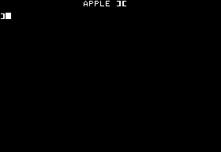
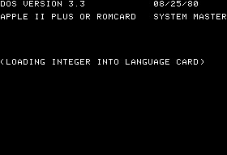
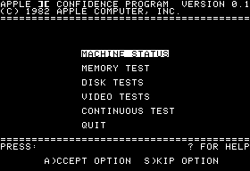
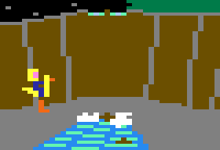
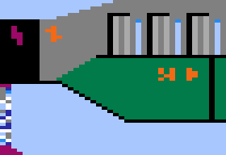

# Apple II Plus

Run the profile from the repository root after building the emulator.

```powershell
.\bin\sbc6502.exe apple2.ini
.\bin\sbc6502.exe apple2.ini --load "path/to/disk.dsk"
```

On Linux, use `./bin/sbc6502` with the same arguments. Without a disk, the
machine starts in Applesoft BASIC at the `]` prompt.



Enter `PRINT 2+2` and press **Enter** to check keyboard input and BASIC.
The emulator displays `4` and returns to the `]` prompt.

## Firmware

Place the following files in `roms/apple2/`. The links identify the AppleWin
revision used for testing. The ROMs are local files excluded from Git.

| File | Bytes | Function | Source |
| --- | ---: | --- | --- |
| `Apple2_Plus.rom` | 12,288 | Applesoft BASIC and Autostart Monitor | [Download](https://raw.githubusercontent.com/AppleWin/AppleWin/7fd7fd7cbabdb7a28a3f7ba329a2517aa64d6e94/resource/Apple2_Plus.rom) |
| `Apple2_Video.rom` | 2,048 | US text character generator | [Download](https://raw.githubusercontent.com/AppleWin/AppleWin/7fd7fd7cbabdb7a28a3f7ba329a2517aa64d6e94/resource/Apple2_Video.rom) |
| `DISK2.rom` | 256 | Disk II 16-sector boot firmware | [Download](https://raw.githubusercontent.com/AppleWin/AppleWin/7fd7fd7cbabdb7a28a3f7ba329a2517aa64d6e94/resource/DISK2.rom) |

Paths can be overridden in the `[apple2]` section of `apple2.ini`. Relative
paths are resolved from the working directory. The build stages local ROMs in
`bin/roms/apple2/` when it stages the runtime files.

## Test disks

Put the disk images in `data/apple2/` under the project root. These local files
are excluded from Git. The commands below use the filenames in the first column.

| Local file | What to expect | Source |
| --- | --- | --- |
| `dos33-system-master.do` | DOS 3.3 startup screen. Wait for `]`, then enter `CATALOG` to list the disk. | [Apple II System Masters](https://github.com/cmosher01/Apple-II-System-Masters/blob/master/dos330/original330sysmas.do) |
| `apple2plus-diagnostics.dsk` | Apple II Confidence Program. Press **A** to accept or **S** to skip the highlighted option. | [Asimov archive](https://mirrors.apple2.org.za/ftp.apple.asimov.net/images/disk_utils/diagnostics/) |
| `waterfall.dsk` | Color lo-res graphics with an animated waterfall scene. | [Waterfall](https://www.deater.net/weave/vmwprod/waterfall_demo/) |
| `lores-escape.dsk` | A loading screen followed by a graphics demo. Allow about 45 seconds for loading. | [Lo-Res Escape](https://www.deater.net/weave/vmwprod/lores_escape/) |

```powershell
.\bin\sbc6502.exe apple2.ini --load ".\data\apple2\dos33-system-master.do"
.\bin\sbc6502.exe apple2.ini --load ".\data\apple2\apple2plus-diagnostics.dsk"
.\bin\sbc6502.exe apple2.ini --load ".\data\apple2\waterfall.dsk"
.\bin\sbc6502.exe apple2.ini --load ".\data\apple2\lores-escape.dsk"
```







## Disk formats and controls

Use `--load`, set `disk_image` under `[apple2]`, or drop an image onto the SDL
window to mount and boot it. The slot 6 drive accepts read-only 35-track
`.dsk` and `.do` images in DOS sector order, `.po` images in ProDOS sector
order, and `.nib` images with 6,656 bytes per track.

Tested disk images are listed above. ProDOS 2.4.3 reported
`RELOCATION/CONFIGURATION ERROR` during startup in this build.

| Key | Action |
| --- | --- |
| F2 | Reset and attempt a warm start |
| F3 | Restart the Autostart Monitor boot sequence |
| F4 | Eject the disk |
| Left or Backspace | Apple II left arrow and backspace |
| Right | Apple II right arrow |
| Escape | Apple II Escape |
| Ctrl+A to Ctrl+Z | Apple II control codes |

The profile includes a 48 KiB Apple II Plus with the 16 KiB Language Card,
40-column text, low- and high-resolution graphics, mixed modes, and speaker
audio. It shares the project's NMOS 6502 core and uses SDL2 for the host
window, input, and sound. Apple II memory and devices have their own
implementation. High-resolution colors approximate NTSC artifacts. Disk images are
write-protected, and the current profile omits paddles, cassette I/O,
additional slots, and copy-protection timing.
