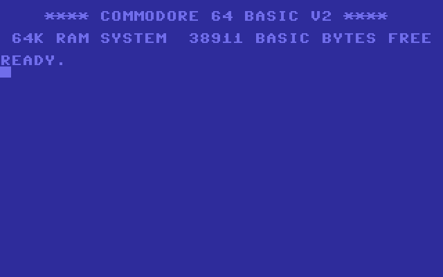
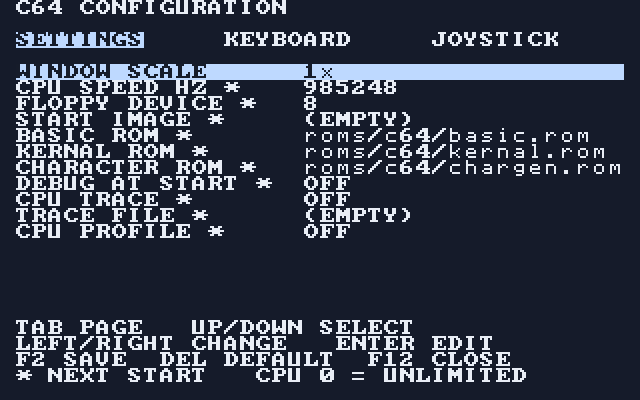

# Commodore 64 (PAL) Mode

The `c64.ini` profile runs C64 BASIC with a 6510-compatible memory map, a
PAL VIC-II display, CIA keyboard and joystick input, and digital 6581 SID audio.



## Start the C64

1. Supply your own C64 ROMs and place them under `roms/c64/` in the project
   directory. Use the filenames defined in [`c64.ini`](../c64.ini).

   | ROM | Filename | Size |
   | --- | --- | ---: |
   | BASIC | `basic.rom` | 8192 bytes |
   | KERNAL | `kernal.rom` | 8192 bytes |
   | Character generator | `chargen.rom` | 4096 bytes |

2. Run `make` to build the emulator and stage its runtime files. On Windows,
   open [`Start-C64.bat`](../Start-C64.bat) in the project directory. The
   launcher reads the project's `c64.ini` at every start.
3. At the `READY.` prompt, enter `PRINT 7*6`. BASIC displays `42`.

From a Windows PowerShell terminal in the project directory, use:

```powershell
.\bin\sbc6502.exe c64.ini
```

The original C64 ROMs are supplied locally and omitted from version control.

## Mount a disk and run a program

Drop a standard 35-track `.d64` onto the running C64 window. The window title
shows the mounted image and device number. The default device is 8. To list
the disk directory, enter:

```basic
LOAD "$",8
LIST
```

Loading the directory replaces the program currently in BASIC memory. To load
a PRG from the disk, use the filename shown between the quotes, or use `*` to
select the first PRG. The `,1` secondary address uses the load address stored
in the file. Use `RUN` for programs with a BASIC entry point.

```basic
LOAD "*",8,1
RUN
```

For a startup disk, enter its path in **START IMAGE** in the F12 menu or drop
a `.d64` onto the open menu. Save with **F2**. The new startup disk is mounted
on the next launch. You can also set the path directly in the active INI:

```ini
[floppy]
device = 8
image = data/sdcard/example.d64
```

## Configure the keyboard and joystick

Press **F12** to pause emulation and open the menu. **Tab** switches pages,
**Up/Down** selects a row, **Left/Right** changes its value, and **Enter** edits
the selected field or captures an input binding. **Delete** restores the
default binding on the selected row. **F2** saves to the active INI. **F12**
closes the menu and discards unsaved edits.



- **SETTINGS** sets the window scale, CPU speed, floppy, and ROM files. The
  window scale takes effect on save. Fields marked `*` take effect on restart.
- **KEYBOARD** assigns PC keys to C64 keys. By default, Escape and Tab send
  `RUN/STOP`, and Page Up sends `RESTORE`. Close the window to exit C64 mode.
- **JOYSTICK** selects C64 port 1 or 2, or disables joystick input with **OFF**.
  **KEY** rows assign PC keys. **PAD** rows capture a button, axis, or D-pad
  direction from the first detected USB joystick or gamepad.

## Compatibility and documentation

The PAL VIC-II implements raster splits, fine scrolling, and eight sprites
with multicolor, expansion, priority, and collision interrupts. Timing within
a scanline and sprite DMA bus steals are approximated or outside current
coverage. D64 access is read-only and uses KERNAL `LOAD` and `VERIFY`.
Software that relies on its own 1541 fastloader, disk writes, tapes, or
cartridges requires additional emulation support.

- [German user manual (PDF)](../output/pdf/6502-SBC-Emulator-Handbuch.pdf)
- [C64 architecture](ARCHITECTURE.md#c64-profile)
