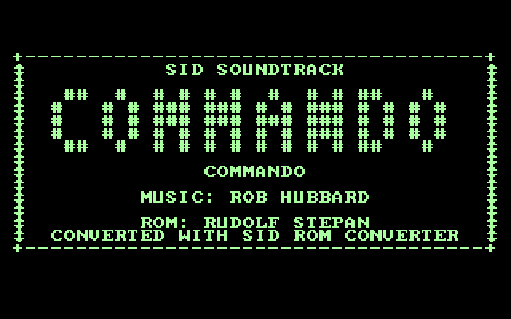

# SID-ROM-Konverter

Die Desktop-Oberfläche erstellt aus einer SID-Datei ein bootfähiges
16-KiB-ROM für den 6502 SBC. Der VIC zeigt den Spielnamen
als ASCII-Titel, die Musik-Credits aus der SID-Datei und den Hinweis
`CONVERTED WITH SID ROM CONVERTER`. Der Name unter `ROM:` ist editierbar
und steht standardmäßig auf `Rudolf Stepan`.

## Oberfläche starten

```powershell
python tools/sid_convert/sid_gui.py
```

Benötigt Python 3.10 oder neuer mit Tkinter sowie `ca65` und `ld65` aus
dem cc65-Paket im Suchpfad. Der Export für den Vierstimmenchip benötigt
zusätzlich GCC. Bei Bedarf lassen sich die Werkzeuge über `CC`, `CA65`
und `LD65` auswählen.

1. SID-Datei wählen. Der Konverter übernimmt Titel und Standardstück aus
   dem PSID-Header.
2. ROM-Ziel wählen und bei Bedarf Titel, Namenshinweis und Stücknummer ändern.
   **Original-SID an $D400** ist standardmäßig aktiviert.
3. Mit **Vorschau** den ASCII-Bildschirm prüfen und **ROM erstellen** wählen.

## Auf der Kommandozeile

```powershell
.\bin\sbc6502.exe .\sid.ini
.\bin\sbc6502.exe .\sid.ini -r ".\roms\sid\fpga\sound_commando.rom"
```

`sid.ini` lädt standardmäßig Commando. Das Profil erwartet ein Split-ROM mit
den Fenstern `$A000–$CFFF` und `$F000–$FFFF`. `-r` ersetzt beide Bänke.
Der Originalplayer schreibt an `$D400`. Für Commando übernimmt das ROM die
Nutzdaten und Einsprungadressen aus der PSID-Datei.
Der native Export unterstützt PAL-PSID-Stücke mit eigener Play-Adresse und
Nutzdaten im SBC-RAM unterhalb von `$6000`.

```powershell
python tools/sid_convert/build_sid_rom.py ../6502-sbc-fpga/sid_orig/Commando.sid roms/sid/fpga/sound_commando.rom --native
```

### Eigener Vierstimmenchip

Mit deaktiviertem **Original-SID** oder ohne `--native` erzeugt der Konverter
einen Ausschnitt für `sound_chip4`.

```powershell
python tools/sid_convert/build_sid_rom.py sid_demo/World_Record_2.sid roms/sid/sbc/World_Record_2.rom
.\bin\sbc6502.exe soundtest.ini -r roms/sid/sbc/World_Record_2.rom
```

Der Zielordner muss existieren. `--title`, `--credit`, `--seconds` und
`--song` überschreiben die Vorgaben. `--delay` stellt die Framezeit in
Zehntelmillisekunden ein und wird auf ganze Millisekunden gerundet. Der
Standardwert `200` ergibt 20 ms pro Frame. Das ROM startet bei `$C000`
und wiederholt standardmäßig einen 30-Sekunden-Ausschnitt.

Der Konverter verarbeitet einzelne PAL-PSID-Stücke mit VBI-Taktung und
expliziter Play-Adresse. Er überträgt Tonhöhe, Wellenform und Hüllkurve
auf den Soundchip. SID-Filter, Pulsbreite und Ringmodulation entfallen.
Wie viel Musik in 16 KiB passt, hängt von der Häufigkeit der Tonwechsel ab.

## Vorhandene FPGA-SID-ROMs mit Titel versehen

```powershell
python tools/sid_convert/title_fpga_roms.py ../6502-sbc-fpga/roms/6502 ../6502-sbc-fpga/sid_orig roms/sid/fpga-titled
```

Das Werkzeug erzeugt Kopien der vorhandenen Split-ROMs mit Titelbildschirm.
Der separate Zielordner hält diese Kopien neben den direkt aus der PSID
erzeugten ROMs.
Es verwendet den freien Kernel-ROM-Bereich ab `$F800` und kehrt danach
zur ursprünglichen Startsequenz zurück. Die Musikdaten, der native Player
und die Interruptvektoren bleiben erhalten. Das ROM-Layout ist `$A000–$CFFF`
plus `$F000–$FFFF`. Beim manuellen Start im FPGA-Monitor dient der
Resetvektor des jeweiligen ROMs als Einstiegspunkt.



Das [Handbuch](../../output/pdf/6502-SBC-Emulator-Handbuch.pdf) enthält
weitere Beispiele sowie eine Beschreibung des Reset- und Audioablaufs.

## Entwicklertest

`make test-sid-rom` erzeugt kleine Test-ROMs und prüft Bildschirmtext,
Soundregister und den ROM-Wechsel in beiden Bänken. `make test-sid6581`
prüft den digitalen Emulator-SID gegen 50.000 Referenzsamples des FPGA-Kerns.
`siddump.c` und `convert_sid.py` lassen sich
auch einzeln verwenden, um SID-Registerframes als Rohdaten zu erfassen
und daraus ca65-Quelltext zu erzeugen.
